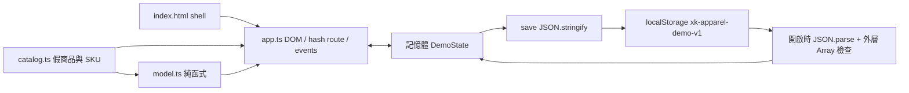

# HQ-001-A — Architect Agent 工作回報

## 任務與範圍

- Task ID：HQ-001；子任務：HQ-001-A。
- Project：`codex-xk-apparel-store`；Repository：<https://github.com/xk2022/codex-xk-apparel-store>。
- 角色：Architect Agent。已讀取並套用 HQ 的 `.codex/agents/architect.toml`、`AGENTS.md`、`templates/AGENT_REPORT.md`，以及目標專案 `AGENTS.md`。
- 查核日期／時區：2026-11-16／UTC。
- 來源分支：`main`；完整 Commit SHA：`1d4f2acad5475f4d2b8c4c16a11377fe2ffe4422`。
- 唯讀來源：`/workspace/scratch/HQ-001-1qnZaIVi/source`。
- 授權：Main Agent 指派靜態架構盤點；本輪使用者要求 READ ONLY、不修改已追蹤檔案、不建立 Commit、不部署、不接觸正式憑證。
- 唯一寫入產出：HQ 的本檔 `projects/codex-xk-apparel-store/reports/HQ-001/architect-report.md`，原先未追蹤。
- 子任務結果：已交付靜態分析，待 Main Agent 整合驗收；不替總任務宣告完成。

本報告所有 `path:line` 引用均指向上述完整 SHA；可由 [固定版本原始碼](https://github.com/xk2022/codex-xk-apparel-store/tree/1d4f2acad5475f4d2b8c4c16a11377fe2ffe4422) 查核。「已驗證」指實際讀取原始碼或命令輸出，不代表已做瀏覽器或正式服務驗證。

## 架構結論與證據

| 結論 | 狀態 | 固定 revision 下的證據 | 限制／影響 |
| --- | --- | --- | --- |
| 無框架的瀏覽器端 TypeScript 靜態 SPA；入口是 HTML 的 ES module，沒有伺服器 API 入口 | 已驗證 | `index.html:19-25`；`src/app.ts:1-21`、`:303-315`、`:589-590`；`package.json:7-15`；`git ls-files` 目錄盤點 | 不能將靜態前端當成正式交易系統 |
| 領域邏輯與介面分為 `catalog.ts`、`model.ts`、`app.ts` 三個模組 | 已驗證 | `src/catalog.ts:1-26`；`src/model.ts:1-3`；`src/app.ts:1-21` | 有基本分層；介面、路由、儲存、後台事件仍集中於單一 `app.ts` |
| Node.js 要求 `>=24`；CI 使用 Node 24；套件為 ESM、私有發佈旗標 | 已驗證 | `package.json:4-6`；`.github/workflows/ci.yml:14-19` | `engines` 未將版本鎖定為單一 patch；實際掃描環境版本由 QA／Main Agent 回報 |
| TypeScript 採 ES2022、ESNext、Bundler resolution、strict、noEmit；略過依賴宣告檢查 | 已驗證 | `tsconfig.json:2-11` | `strict` 是靜態型別檢查，不能驗證 localStorage 的外部 JSON |
| 建置先 `tsc --noEmit`，再由 esbuild 產生多檔 ESM 與單檔離線 IIFE | 已驗證 | `package.json:8`；`build.mjs:3-25`、`:26-50` | 原始碼 `index.html` 不是可直接使用的完整成品，因其引用 `assets/app.js`／`assets/styles.css` |
| 一般成品為 `dist/`；離線成品為含 CSS、JS 與九張 JPEG 的 `review.html` | 已驗證 | `build.mjs:14-17`、`:26-50`；`README.md:18-23` | 本 Agent 沒有執行建置，不能憑程式碼宣稱本次產物成功 |
| `dist/`、`review.html`、`node_modules/` 不追蹤 | 已驗證 | `.gitignore:1-3`；`git ls-files` | 容許隔離測試產物，不代表容許修改已追蹤原始檔 |
| CI 只做安裝、測試、上傳 14 天保存的 review 產物；該 YAML 沒有 Pages 發布步驟 | 已驗證 | `.github/workflows/ci.yml:1-26` | 不能把 CI 成功等同 Pages 已更新 |

## 目錄與責任

```text
index.html                  HTML shell、展示提醒、a11y 根節點
styles.css                  響應樣式
src/catalog.ts              Product／Variant 型別、8 款假商品、查詢與 clone
src/model.ts                購物車、整數金額、驗證、訂單快照、取消回補
src/app.ts                  DOM render、hash route、事件、展示會員、後台與 storage
assets/                     hero + 8 張商品 JPEG
tests/model.test.mjs        領域規則測試
tests/ui.test.mjs           happy-dom 介面互動測試
tests/artifact.test.mjs     離線產物與資源檢查
build.mjs                   型別檢查後的 esbuild／資產打包
.github/workflows/ci.yml    Node 24 的 PR／main push／手動檢查
docs/                       REQUIREMENTS、DATA_MODEL、ACCEPTANCE、HANDOFF、ASSET_SOURCES
```

證據：本 Agent 執行的 `git ls-files`；檔案職責另見 `README.md:51-59`、各模組 import 與函式定義。此版本沒有後端服務、ORM、Migration 或正式 DB 設定；`docs/DATA_MODEL.md:3-5` 明示該文件是未核准的候選草案。

## 實際元件與資料流



- 商品查找：`findProduct(idOrSlug)` 比對商品 ID 或 slug；`findProductByVariant(variantId)` 線性查找第一個匹配 SKU。證據：`src/catalog.ts:119-132`。
- 路由：`#checkout`、`#admin`、`#order/<id>`、`#product/<id>`，其他 hash 回首頁／商品列表；註冊 `hashchange` 後立即 `route()`。證據：`src/app.ts:303-315`、`:589-590`。
- 前端選購：現貨／預購、分類、搜尋、排序 → 商品規格 → 購物袋 → 訪客結帳 → 本機訂單；會員僅切換 boolean，後台修改本機配額或取消本機訂單。證據：`src/app.ts:140-164`、`:183-230`、`:250-301`、`:390-400`、`:450-459`、`:500-559`。
- 輸入更新後以 `save()` 整包保存；沒有伺服器 round trip。證據：`src/app.ts:28-64`、`:372-382`、`:423-432`、`:549-554`。未透過實際瀏覽器操作驗證此流程。

## 實際資料模型

| 型別／結構 | 實作內容與關係 | 證據 |
| --- | --- | --- |
| `Product` | `id`、`slug`、名稱、分類、整數價格、主圖／圖片陣列、說明／材質／版型、`variants[]`；價格在 Product 層 | `src/catalog.ts:12-24` |
| `Variant` | SKU ID、顏色／色碼／尺寸、`stock` 有限可購配額、`preorder`、`leadDays` | `src/catalog.ts:1-10` |
| `CartLine`／`CartSummary` | 行只存 SKU ID 與數量；摘要重新解析目前商品、SKU、金額、一次運費、混單、最長備貨日與問題列表 | `src/model.ts:11-30`、`:95-125` |
| `CheckoutDetails` | 姓名、電話、Email、示意門市、`card` 或 `cod`；沒有卡號欄位 | `src/model.ts:31-33`；`src/app.ts:250-251` |
| `OrderItem` | 商品／SKU ID、名稱、圖、顏色、尺寸、`price`／`unitPrice`、數量、行金額、預購／交期快照 | `src/model.ts:34-45`、`:176` |
| `MockOrder` | ID／時間、訂單與付款狀態、客戶示意資料、品項與金額、混單政策、`stockRestored`、`simulated: true` | `src/model.ts:46-67`、`:172-180` |
| `DemoState` | `products`、`cart`、`orders`、`member` 四者同存一份瀏覽器 JSON | `src/app.ts:28-50`、`:55-57` |

實際型別與 `docs/DATA_MODEL.md:42-56` 的正式候選資料表不同：候選有會員、支付、物流、發票、保留、冪等紀錄與 outbox；程式並未建立這些資料庫表或服務。正式候選模型亦將 SKU 價格列於 variants，而當前 Product 型別是單一商品價格；遷移時須先決定變價粒度，不能假設原型已支援 SKU 各自定價（`src/catalog.ts:12-24`；`docs/DATA_MODEL.md:44-46`）。

## 模型演算法與保護

1. `normalizeCart` 合併重複 SKU，拒絕非陣列、空 SKU、非正安全整數與合併溢位。證據：`src/model.ts:76-92`。
2. `getCartSummary` 拒絕不存在 SKU、無效／不足配額、負或非安全整數價格、行金額／小計／總件數溢位。非空且無問題、所有行都解析成功才可結帳。證據：`src/model.ts:95-125`。
3. 運費是小計低於 NT$2,000 時收 NT$65；空車零運費；現貨與預購混單取最長備貨日並整單一次運費。皆為示意政策，非商家承諾。證據：`src/model.ts:5-9`、`:115-124`；`docs/REQUIREMENTS.md:44-57`。
4. `updateQuantity` 的零值是移除，負值／非整數拒絕，預購同受 `stock` 限制；`addToCart` 累加後交由同一檢查。證據：`src/model.ts:128-144`。
5. `createMockOrder` 先查 ID 重試、驗證聯絡資料與全車，再 clone 商品、扣配額、產生品項與金額快照；不修改傳入商品。證據：`src/model.ts:146-181`；`src/catalog.ts:131-132`。
6. `cancelMockOrder` 只允許 `preparing`；已取消或已回補即不再回補；先驗證所有 SKU 與回補整數，再 clone 全部回補。COD 改為取消、card 為模擬退款；沒有真實退款呼叫。證據：`src/model.ts:184-195`。

以上是靜態原始碼保護的確認，並非本 Agent 的執行測試結果。單次函式 clone／驗證不等於資料庫交易或跨分頁原子性；程式註解與設計文件亦明示此限制（`src/model.ts:157`；`docs/DATA_MODEL.md:14-17`）。

## 儲存、提交順序與架構風險

| 項目 | 已驗證事實／推論 | 風險與後續建議 |
| --- | --- | --- |
| 啟動載入未深度驗證 | 已驗證：只確認 `saved.products`、`cart`、`orders` 是 Array，再展開為 state，member 轉 boolean；未檢查 Product／Variant／Order 內部 shape（`src/app.ts:42-50`） | 推論：舊版、損壞或手改 JSON 可使 `p.variants` 等存取失敗。建議增加版本化 schema、逐項驗證與可復原的重設流程；未實作或動態重現 |
| 儲存失敗不阻擋成功流程 | 已驗證：`save()` 捕捉錯誤、只顯示一次提醒、不回傳成功與否；下單先改記憶體與清車，save 後仍進成功 hash（`src/app.ts:54-64`、`:541-559`） | 推論：儲存被禁用或 quota 滿時，當次畫面可成功，重載後不保留；符合記憶體 fallback，但結帳文案應明示。正式系統需伺服器確認後才宣告建立 |
| 全狀態覆寫、沒有跨分頁同步 | 已驗證：載入只於開啟時執行，save 整包 JSON，僅有 hashchange listener（`src/app.ts:28-64`、`:589-590`） | 推論：多分頁各持舊 state 可互相覆蓋／遺失更新；不是跨使用者庫存系統。正式系統需 DB 交易、條件更新及併發驗收 |
| 冪等僅按 ID | 已驗證：若 `existingOrders` 有同 ID 即回傳舊 order，不比對目前請求內容／身分（`src/model.ts:159-162`） | 原型邊界，未證實跨使用者漏洞。正式 API 需操作範圍、請求雜湊與唯一約束；同 key 不同內容拒絕 |
| 訂單 ID 與取消信任呼叫端 | 已驗證：ID 由 Date.now／Math.random 組合；取消信任傳入 order 的狀態、品項、回補旗標（`src/app.ts:543-547`；`src/model.ts:185-195`） | 適用假資料展示；不能用作正式查單憑證、授權或退款依據。正式服務應由伺服器權威資料處理 |
| UI 耦合集中 | 已驗證：render、路由、事件、localStorage 與提交在 590 行 `app.ts`，多處整段 `innerHTML` 更新（`src/app.ts:102-315`、`:318-590`） | 推論：新增正式 API、loading／error／重試及多畫面時維護成本增加；先抽 state／storage adapter、路由與 feature renderer，無需本次立即更換框架 |
| 正式資料結構尚未實作 | 已驗證：`docs/DATA_MODEL.md:3-5`、`:42-58`、`:69-99` 是候選設計，repo 無 DB／backend | 商業化依賴後端權威價格、資料庫保留／交易、認證與金物流／發票，不可直接把 Pages 原型切為正式營運 |

## 文件與部署邊界

- 已驗證文件落差：`README.md:7`、`:25-35` 與 `docs/HANDOFF.md:34-49` 說 Pages 已發布；`docs/REQUIREMENTS.md:80-82` 仍寫「尚待啟用與驗證」。需在未來授權文件修訂時對齊時間與實際狀態。本 Agent 不編輯來源文件。
- 已驗證設計：README 指 `main` 為原始碼、`gh-pages` 根目錄為成品，兩者不自動同步；CI YAML 只上傳 artifact（`README.md:27-35`；`.github/workflows/ci.yml:18-26`）。
- 未執行：本 Agent 未連線 Pages、未查遠端 workflow run、未驗證線上產物與當前 SHA 一致。歷史文件中的 HTTP 200 與 run 成功不能自動當作本次驗證，待 Main／Security 的實測證據整合。

## 命令、測試與變更

| 實際命令類型 | Exit code | 結果與範圍 |
| --- | --- | --- |
| `git rev-parse HEAD`、`git status --porcelain` | 0 | SHA 如上；本 Agent 初查來源工作目錄無變更 |
| `git ls-files` | 0 | 目錄盤點；本版本共 30 個追蹤檔，含 3 個 TS 模組與 3 個測試檔 |
| `nl -ba`／`sed -n`／`rg -n`／`wc -l` 的定向讀取 | 0 | 逐行核對 package、tsconfig、build、catalog、model、app、CI 與設計／交接文件；讀取 HQ 規範與模板 |
| `npm ci`／`npm test`／coverage／瀏覽器 | 未執行 | 依 Main 分工，本 Agent 僅靜態查核；QA／Main 應提供實際命令、環境、結果與限制 |

- 實際建立檔案：只有本報告；沒有變更受管理專案或 HQ 的已追蹤檔案。
- 未建立 Commit、未推送、未部署、未接觸正式服務／憑證，亦未保存 Token。
- 另由唯讀子任務獨立複核模型邊界；本 Agent 已回讀對應原始碼，僅納入有上述行號支持的結論。
- 原型的測試通過不代表真實瀏覽器排版／觸控、正式服務、資料庫併發或商業營運可用；測試結果與覆蓋率由 Main／QA 補入整合報告。

## 建議順序與驗收

1. 先以本次 QA 結果與固定 revision 建立可重現基準，並對齊部署文件和實際 Pages 狀態。
2. 原型穩定性優先補 localStorage schema／復原、保存失敗提示、跨分頁資料限制與真實瀏覽器／手機驗收。
3. 商業化前核准正式架構與政策；後端權威商品價格、身分授權、DB 交易／保留／冪等及個資治理先於真實支付與物流啟用。
4. 將候選商品／訂單／支付／物流／發票模型轉為經審查的 schema／Migration，補交易失敗、併發與回調重送測試，再談正式上線。

以上是建議，不是新功能或部署授權。Main Agent 複核結果：待驗收。專案獨立工作紀錄、總任務狀態與最後三份交付由 Main Agent 決定；本輪使用者禁止修改已追蹤檔案，應以新報告記錄本次結果。
