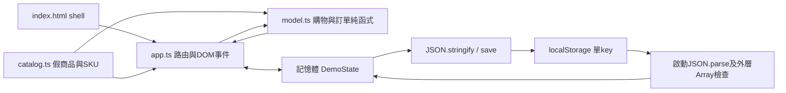
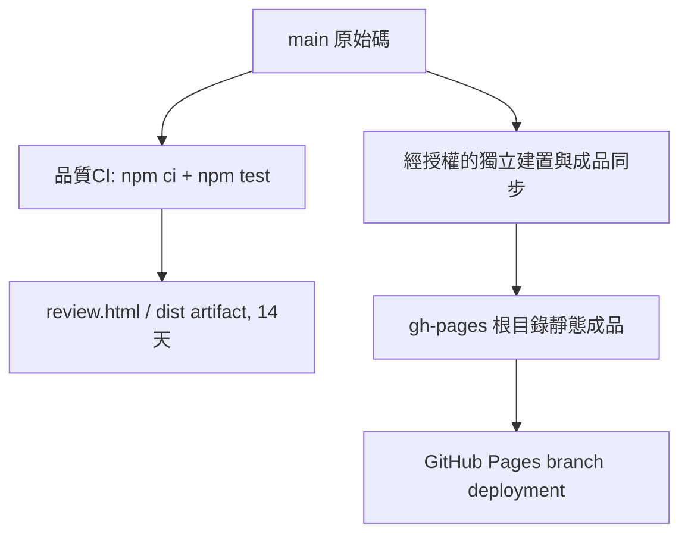

# HQ-001：Architecture

查核：2026-11-16 UTC。所有來源引用固定於 [main@1d4f2acad5475f4d2b8c4c16a11377fe2ffe4422](https://github.com/xk2022/codex-xk-apparel-store/tree/1d4f2acad5475f4d2b8c4c16a11377fe2ffe4422)。Main Agent整合Architect實際來源盤點及QA／Security證據；本次沒有修改架構。

## 1. 系統邊界

目前是**單一瀏覽器的靜態服飾商城試作**：TypeScript → esbuild靜態成品 → DOM介面與純函式模型 → 記憶體及localStorage。沒有後端API、伺服器授權或真實DB；正式服務設計只是候選（`package.json:7-15`、`src/app.ts:1-64`、`README.md:49`、`docs/DATA_MODEL.md:3-5`，tracked tree）。

證據：`src/app.ts:1-64,303-315,541-559`、`src/model.ts:1-3,157-195`、`src/catalog.ts:119-132`。圖中不包含正式付款、物流、DB或認證，因本版本沒有這些執行元件。

## 2. 目錄與模組責任

| 路徑 | 責任與證據 |
| --- | --- |
| `index.html`／`styles.css` | HTML shell、展示標籤、DOM根節點／響應式樣式；`index.html:14-25`，`README.md:56` |
| `src/catalog.ts` | Product、Variant、8款商品與SKU、clone／lookup；`:1-132` |
| `src/model.ts` | 購物車、安全整數與配額、運費、結帳、訂單快照、取消回補；`:5-195` |
| `src/app.ts` | renderer、hash路由、事件、購物袋、結帳草稿、展示會員、後台、localStorage；`:28-64,102-315,318-590` |
| `assets/` | hero與8商品JPEG，內嵌離線版或複製至dist；`build.mjs:16,26-37` |
| `tests/` | 15模型、6 DOM、4產物測試；三個 `.test.mjs` 與 [test log](evidence/npm-test.log) |
| `build.mjs`／`tsconfig.json` | esbuild與資產生成；strict/noEmit型別檢查設定；`build.mjs:3-50`、`tsconfig.json:2-12` |
| `.github/workflows/ci.yml` | Node24安裝、測試及上傳產物，沒有部署step；`:1-26` |
| `docs/` | REQUIREMENTS／DATA_MODEL／ACCEPTANCE／HANDOFF／ASSET_SOURCES；源碼樹、README `:57` |

## 3. Node、TypeScript與建置架構

- `type: module`、Node `>=24`、私有套件；實測Node v24.22.1／npm11.9.0（`package.json:4-6`；[runtime.json](evidence/runtime.json)）。`private: true` 是npm發布旗標，不代表GitHub儲存庫私有。
- TypeScript目標ES2022、ESNext、Bundler解析、strict、noEmit、skipLibCheck，僅include `src/**/*.ts`（`tsconfig.json:2-12`）。型別檢查不能驗證儲存JSON的執行時結構。
- `npm test` → `npm run build` → `tsc --noEmit && node build.mjs` → Node test runner（`package.json:8-9`）。本次整段成功，[npm-test.log](evidence/npm-test.log)。
- `dist/`：三個ESM模組、source maps、CSS、HTML、9張JPEG與`.nojekyll`；`review.html`：IIFE bundle、內嵌CSS及data-URL圖，無需外部資源（`build.mjs:3-50`；`tests/artifact.test.mjs:10-92`）。
- 只有隔離副本產生成品，`.gitignore:1-3` 排除`node_modules/`、`dist/`、`review.html`。本次建置不代表有新部署。

## 4. 實際資料模型

| 模型 | 主要欄位／關聯 | 來源 |
| --- | --- | --- |
| Product | id、slug、name、category、整數price、image／images、description／material／fit、variants[] | `src/catalog.ts:12-24` |
| Variant | id為SKU識別；color／colorHex、size、有限stock、preorder、leadDays | `src/catalog.ts:1-10` |
| CartLine | variantId、quantity；摘要解析目前商品／SKU後計算金額與issues | `src/model.ts:11-30,76-125` |
| CheckoutDetails | name、phone、email、store、method=`card`／`cod`；不包含卡號 | `src/model.ts:31-33` |
| OrderItem | variantId／quantity加上productId、品名／圖／顏色尺寸／單價／行金額／預購交期快照 | `src/model.ts:34-45,176` |
| MockOrder | id、createdAt、status、paymentStatus、customer、items、金額／件數／混單／交期、stockRestored、simulated | `src/model.ts:46-67,172-180` |
| DemoState | products、cart、orders、member，整份JSON存於同一瀏覽器key | `src/app.ts:28-64` |

商品價格目前在Product層，不是每SKU單獨定價。`docs/DATA_MODEL.md:44-46` 的候選variants價格欄位屬未來設計，正式化須先確認變價粒度，不能假定已實作。

### 領域流程與不變量

1. 正規化購物車合併SKU、拒絕非正安全整數與溢位；重算摘要檢查SKU存在、價格與可購量（`src/model.ts:76-125`）。
2. 訪客聯絡資料驗證後，全單合法才clone商品扣配額，產生價格與品項快照；不改傳入庫存（`:146-181`）。
3. 現貨／預購同受有限可購量限制。混單等最長示意備貨日、整單一次運費；NT$65及滿NT$2,000免運是可調原型假設（`:5-9,115-144`、`docs/REQUIREMENTS.md:44-66`）。
4. 同訂單ID重試回傳舊order；取消僅處理備貨中且未回補的訂單，先檢查全單後clone回補，避免本機重複扣補（`:159-162,184-195`）。
5. card只標`simulated_paid`／`simulated_refunded`，COD為`cod_pending`；沒有支付／退款呼叫（`:174,193-195`、`src/app.ts:251`）。

上述受既有模型測試支持，本次25項全通過；單函式clone與順序操作仍不是DB交易、真正API冪等或跨使用者庫存鎖（[test log](evidence/npm-test.log)、`docs/ACCEPTANCE.md:36,47`）。

## 5. UI、狀態與儲存順序

- hash路由支援`#checkout`、`#admin`、`#order/<id>`、`#product/<id>`，其他走首頁；`hashchange`後重新render（`src/app.ts:303-315,589-590`）。
- 商品詳情只使用主圖`p.image`；雖型別有images[]，目前未見gallery（`:208-217`、`src/catalog.ts:12-24,26-116`）。
- 結帳先驗證，再更新products／orders、清cart／draft、`save()`、導向成功hash（`src/app.ts:519-559`）。
- localStorage key=`xk-apparel-demo-v1`；載入只檢查products／cart／orders為Array，再直接採用內部結構；保存catch只提示一次，不回傳是否持久化成功（`:34,42-64`）。
- 展示會員只改boolean；`#admin`沒有正式身分授權，配額與取消僅作用於本機假資料（`:290-301,390-400,450-452,500-517`）。

架構改善候選：

| 觀察 | 影響與驗收方向 | 證據／驗證狀態 |
| --- | --- | --- |
| 無深度schema及版本遷移 | 壞JSON／舊版資料可能造成renderer例外；需定義可復原驗證與重設策略 | `src/app.ts:42-50`；靜態推論，未注入重現 |
| save失敗仍可進成功頁 | 記憶體中存在但重載可能遺失；改善持續提示及成功語意 | `:54-64,549-554`；靜態推論，已有toast fallback |
| 全狀態覆寫、無storage同步 | 多分頁舊state可能覆寫；須明示單頁限制，正式版用DB權威交易 | `:28-64,589-590`；未做跨tab動態測試 |
| ID重試只比ID | 同key不同內容沒有請求雜湊檢查；正式API須身分／操作範圍與唯一約束 | `src/model.ts:159-162`；不宣稱現有遠端漏洞 |
| renderer／路由／儲存同模組 | 接入API、錯誤／重試狀態時維護成本可能提高；先抽adapter及功能邊界 | `src/app.ts:28-590`；維護性推論，不要求本輪更換框架 |

## 6. CI與部署的兩條路徑

中間「獨立建置與成品同步」是README記錄的維護方式，不是本次執行的步驟。源碼CI無Pages發布step，main改動不自動更新gh-pages（CI `:1-26`、README `:27-35`）。

本次API重查：main固定SHA的品質CI成功；gh-pages ref仍為`302f9580fa6b74f153964d8834274510f5f638cc`，歷史Pages run `43359061053` 的build及deploy jobs成功。[github-actions.json](evidence/github-actions.json)、[github-pages.json](evidence/github-pages.json)提供時間與URL。未驗證目前網站HTTP、Pages設定或原碼／產物byte一致；未部署。

## 7. 正式化邊界與驗證限制

`docs/DATA_MODEL.md:42-99` 草案提出會員、商品SKU、庫存保留、訂單品項、payments／events、物流、發票、冪等及outbox；它們不是目前已建資料表。正式化應先確認店家政策與授權，再由伺服器控制價格、身分、庫存交易與支付回調，不可直接把本機state當權威。證據：`README.md:49`、`docs/REQUIREMENTS.md:34,68-76`、`docs/DATA_MODEL.md:3-17,42-99`。

本次完整安裝、型別／建置及25測試已成功，有限coverage僅包含catalog與model，app來源未量測；happy-dom 20.14.6另有High audit finding，並未修補（[scan-report.md](scan-report.md)、[qa-report.md](qa-report.md)、[security-report.md](security-report.md)）。真實瀏覽器、正式服務、多人併發、備份還原及實際商用不在本輪已驗證範圍。
