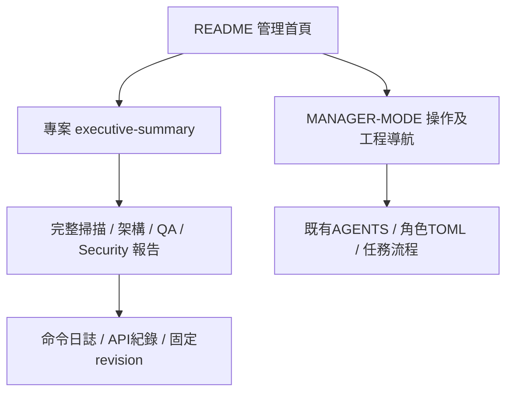

# HQ-002：架構盤點與實作範圍

- 任務：Executive Dashboard — Manager Mode。
- 盤點日期：2026-11-17（UTC）；HQ 基準：`74a9a3290d6c2e198608c6c81b48c9e5091f4098`。
- 本輪已批准 HQ 管理首頁與文件實作、提交及 PR 交付流程；Repository 可見性選擇為 public。新增內容僅限可公開資料，未將可見性選擇解讀為部署授權。
- 產品來源仍採 HQ-001 的固定 revision `1d4f2acad5475f4d2b8c4c16a11377fe2ffe4422`。不修改 public 產品 Repository、不重跑產品測試、不接觸正式憑證、不自行部署。

## 1. 既有架構盤點

下列路徑與行號指上述 HQ 基準，透過[固定版本目錄](https://github.com/xk2022/ai-agent-hq/tree/74a9a3290d6c2e198608c6c81b48c9e5091f4098)可核對。它們描述修改前的狀態，不代表目前仍缺少管理首頁。

| 已驗證現況 | 基準證據 | 本輪處理 |
| --- | --- | --- |
| HQ 是 Markdown／YAML／TOML 管理文件庫，沒有 Web app、建置或 hosting 設定 | 基準 tracked tree；`README.md:15-30` | 使用 Repository 原生 Markdown，不新增服務或部署流程 |
| 首頁主要呈現目錄、流程及14個 Agent，缺少健康、風險與待決策總覽 | `README.md:7-68` | 首頁改為管理者優先；工程入口保留於 MANAGER-MODE |
| Main 已管理派工、owned paths、子報告與驗收 | `AGENTS.md:7-14,29-37` | 維持既有角色、TOML、派工與驗收機制 |
| 首頁、registry、project 及任務仍顯示 HQ-001 pending／pending_scan | `README.md:11-12`、`projects/registry.yml:6`、`projects/codex-xk-apparel-store/project.yml:6,9`、`tasks/inbox/HQ-001.md:5` | Main 依已驗收紀錄對齊有效管理資料，不修改歷史掃描報告 |
| HQ-001 已有完成與驗收證據；當時禁止修改已追蹤管理資料 | `reports/HQ-001/execution-record.json:8-10,68-69,86-92`、`scan-report.md:117-118` | 將新管理狀態與歷史限制分開記錄，不讓首頁繼續把已完成掃描顯示未執行 |
| 25／25 測試、High 依賴發現、有限 coverage 及未驗項目已有證據 | `scan-report.md:17-24,80-86,103-111`、`execution-record.json:47-65,78-84` | 重用有日期及 revision 的證據，不宣稱本輪已重新測試或已修補 |

## 2. 採用的管理閱讀架構

首頁以摘要為主，原始報告與證據仍保留。首頁與摘要不得成為改寫命令結果或自動授權新工作的來源。這個閱讀層沒有常駐程序，不宣稱會自動更新或背景監看。

資料分為四個獨立維度：任務／專案流程狀態、健康判斷、商業就緒度、授權／決策狀態。每項結論的證據狀態另外標示已驗證、推論、未執行或未知；行動批准狀態獨立使用不需批准／待批准／已批准／拒絕。目前候選建議仍待批准，不代表已執行。`scan_completed` 不代表 `Healthy`，測試全通過不代表正式商用就緒。分類定義由[專案健康及風險規格](../../../../docs/PROJECT_HEALTH_AND_RISK.md)管理。

## 3. 實作分工與檔案邊界

| 工作包 | 主要檔案 | 負責整合與驗收 |
| --- | --- | --- |
| WP-1 統一摘要 | [摘要模板](../../../../templates/EXECUTIVE_SUMMARY.md)、[第一份專案摘要](../../executive-summary.md) | Research 定義內容；Main 核對證據 |
| WP-2 管理首頁 | [README](../../../../README.md)、[MANAGER-MODE](../../../../MANAGER-MODE.md) | Main 實作首頁；Architect 保留工程導航與更新流程 |
| WP-3 健康及風險 | [分類規格](../../../../docs/PROJECT_HEALTH_AND_RISK.md) | Research 提案；QA／Security 審核；Main 接受 |
| WP-4 報告導航 | 摘要 → [HQ-001 掃描](../HQ-001/scan-report.md)／[架構](../HQ-001/architecture.md)／[路線](../HQ-001/roadmap.md) → `evidence/` | Main 檢查連結與來源，不改 HQ-001 歷史內容 |
| 有效管理資料對齊 | registry、project.yml、有效任務位置、專案 work-log | Main 記錄對齊依據；既有任務狀態流程不變 |
| 驗證交付 | [QA](qa-report.md)、[Security](security-review.md)、[Main](main-report.md) | 各角色回報；Main 最終整合，保留未驗證事項 |

本 Architect 子任務只編輯本檔及 MANAGER-MODE，未修改其他檔案、Agent 設定、公共產品或 Git 提交；其餘檔案由各自派工負責人處理。

## 4. 更新與一致性規則

1. 專業 Agent 依既有派工交付，Main 核對原始證據及來源 revision 後驗收。
2. 先更新有效任務與專案工作紀錄，再維護摘要及首頁索引；衝突揭露並查證，不以舊登錄蓋過已驗收執行結果。
3. 摘要分開記錄「摘要更新日期」和「證據查核日期」。本例呈現2026-11-16測試結果，不把2026-11-17文件更新當成今日重跑。
4. Main 建議與管理者待決策欄位分開；只把明確批准的具體範圍記為已授權。修補、產品開發或部署都不因出現在 roadmap 而自動開工。
5. QA 檢查首頁／摘要／報告／原始證據數值一致，Security 檢查公開資料邊界，再由 Main 交付。

## 5. 公開與部署邊界

Repository 目前為 public，首頁、深層檔案與 Git 歷史都公開。折疊技術區塊只改變閱讀方式，不提供存取控制。不得新增私人資料、客戶內容、秘密、正式憑證、內部環境路徑或原始對話；新增摘要只引用適合公開的最少必要資料。

本輪不新增外部分析、遠端腳本、badge、網站、hosting 設定或部署工作流。public 可見性與本輪文件提交授權，不涵蓋 GitHub Pages 或其他網站部署。完整邊界見 [MANAGER-MODE](../../../../MANAGER-MODE.md)與[Security 審查](security-review.md)。

## 6. 驗收界線

- 機械與角色審查：摘要必要欄位、五類健康狀態、風險級別、證據日期、來源連結、25／25與1 High 套件／2公告的正確性，以及未執行事項不誤標通過。
- 相容性：14份角色TOML、Main派工、owned paths、任務狀態流程及HQ-001歷史保持原有機制與內容。
- 人類閱讀：管理者開啟首頁後10秒內回答六個問題，須另有實際計時驗收。文件實作、連結檢查、Commit或合併都不能代替這項結果。
- HQ-002 在人類閱讀驗收前維持 `awaiting_review`；詳細已驗證與未完成項目由 [QA](qa-report.md)及 [Main](main-report.md)記錄，不預先宣告全部驗收完成。
